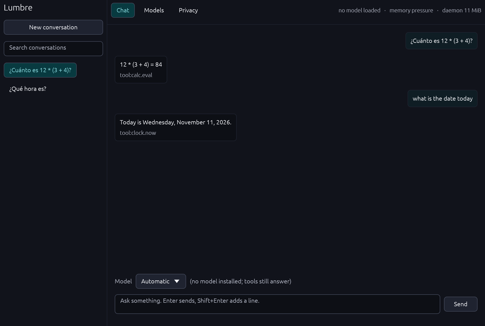
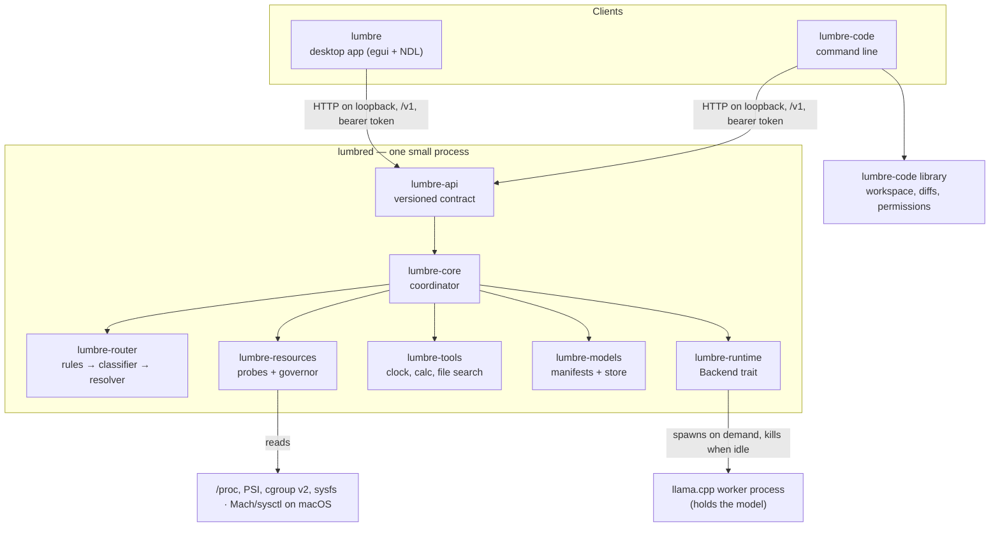

<div align="center">
  <a href="https://getnodalia.com">
    <picture>
      <source media="(prefers-color-scheme: dark)" srcset="https://raw.githubusercontent.com/danielmigueltejedor/nodalia-web/main/assets/brand/nodalia-wordmark-white.svg">
      
    </picture>
  </a>
  <br><br>
  
  <h1>Lumbre</h1>
  <p><strong>Local AI that adapts to your computer, not the other way round.</strong></p>

  <p>
    
    
    
    
    <a href="./LICENSE"></a>
  </p>

  <p>
    <a href="#what-it-is">What it is</a> ·
    <a href="#how-it-differs-from-an-llm-manager">Differences</a> ·
    <a href="#components">Components</a> ·
    <a href="#architecture">Architecture</a> ·
    <a href="#resource-management">Resources</a> ·
    <a href="#privacy">Privacy</a> ·
    <a href="#building">Build</a> ·
    <a href="#using-it">Use</a> ·
    <a href="#status">Status</a> ·
    <a href="#roadmap">Roadmap</a>
  </p>
</div>

<p align="center">
  
</p>

---

> [!IMPORTANT]
> **Lumbre 0.1 is a foundation, not a finished assistant.** The coordinator, the resource
> governor, the local API, the tools, the model store and the `lumbre-code` command line work and
> are tested. Inference through llama.cpp is implemented but **has not yet been run against a real
> model by this project**; see [Status](#status) for exactly what is and is not verified.

## What it is

Lumbre is a local AI platform: an assistant, a coding agent and the model infrastructure they
share. It runs on your computer, with no account, no subscription and no cloud service. The
network is only used when you ask for something that needs it — in 0.1, downloading a model.

The idea it is built around: **most requests do not need a large language model, and the ones
that do should only take what the machine can spare right now.** So Lumbre decides per request
which system answers it, measures the machine before loading anything, loads one model at a time,
and gives the memory back when you stop using it or when something else needs it.

It is designed for ordinary hardware: no dedicated GPU required, 16 GB of RAM as the reference
machine. Linux is the first platform (Arch, Fedora, Ubuntu, Debian); the architecture keeps
operating-system code behind adapters so macOS and Windows can follow.

## How it differs from an LLM manager

Tools such as Ollama and LM Studio are, at heart, a way to download a model and keep a server for
it running. Lumbre uses the same class of inference engine underneath (llama.cpp) and does not
pretend otherwise. What it adds is the layer above and around it:

| | A model manager | Lumbre |
| --- | --- | --- |
| A request arrives | It goes to the model you selected | A router decides: a tool, or the smallest model tier that fits the request |
| "What time is it?" | A model is loaded and generates an answer | The clock answers; no model is loaded |
| Before loading | Loads what you asked for | Reads memory, memory pressure, power and busy processes, and computes a budget |
| You start a game | The model stays resident | The model is unloaded under memory pressure; new requests are deferred with the reason |
| Idle | A server stays resident | The daemon uses a few MiB and one sleeping thread; with socket activation it is not running at all |
| When it cannot answer | Often an error or a hang | An explicit non-answer that says why (no model installed, deferred, backend missing) |

## Components

- **Lumbre** — the desktop assistant: chat with local history and search, automatic or manual
  model choice, model management, and a discreet indicator of what is loaded and what it costs.
  It is a client of the daemon and shows only what the daemon reports.
- **Lumbre Código** — a coding agent, installable on its own, with the `lumbre-code` command line:
  understand a repository, search files, text and symbols, check and apply changes as reviewable
  diffs, and run commands you allowed. It reuses the same daemon and models; it starts no server
  of its own. An IDE based on Code - OSS is planned: see [docs/code-ide.md](docs/code-ide.md).
- **Lumbre Models** — manifests for open-weight models (publisher, licence, pinned revision,
  size and SHA-256 of every file), download on demand with resume and integrity check, a local
  store, and selection of the quantisation that fits the current budget. Weights are never in Git.

## Architecture



A request goes through three questions, in order, and stops as early as it can:

1. **What does this need?** The router answers with a tool or a model tier — deterministically
   for known operations, with a keyword classifier otherwise, and (in later versions) a micro-LLM
   only for what stays ambiguous. Measured cost of a routing decision: about 0.8 µs.
2. **What can the machine give right now?** The governor answers with a byte budget, a thread
   count and a verdict (run, degrade, defer), each with its reasons.
3. **Which installed model fits both?** The model registry answers with a file — the largest
   quantisation of the requested tier that fits, or a smaller tier, or nothing.

Only then is a model loaded, and never more than one. The model lives in a **worker process**, so
unloading it returns its memory to the system for real, and the daemon stays small.

The reasoning behind each choice (Rust workspace layout, worker process instead of linking
llama.cpp, egui instead of Tauri, HTTP on loopback) is in
[docs/architecture.md](docs/architecture.md).

## Resource management

Lumbre does not promise zero impact; it sets measurable goals and measures them.

| Goal | Measured | Where |
| --- | --- | --- |
| Idle daemon under 20 MiB resident, no model loaded | 6.9 MiB after 20 s idle, 1 thread, 0.01 s CPU | macOS on Apple Silicon, `benchmarks/idle.sh` |
| Same, on Linux | Measured by CI on every run (`linux-runtime` job fails over 20 MiB) | Ubuntu 24.04 x86_64 runner |
| A routing decision costs nothing noticeable | 755 ns average | macOS arm64, `route_bench` example |

What the governor does today ([docs/resources.md](docs/resources.md) has the rules and numbers):

- reads total and available memory, **memory pressure** (PSI on Linux, the kernel pressure level
  on macOS), CPU load, power state, the cgroup v2 memory limit, VRAM where the driver exposes
  it, and the processes using the most CPU;
- computes a model budget from them and from the mode — **auto**, **performance** or **saver** —
  and never exceeds a user-set `max_ram_mb`;
- defers instead of loading under critical pressure, and steps down a tier under elevated
  pressure, on low battery, or when another program is using half the cores;
- unloads a model that has been idle (5 minutes by default) or when pressure persists, with
  hysteresis and a reload cooldown so it does not oscillate.

Not there yet: adjusting the context size on the fly, NVIDIA VRAM (needs NVML), per-model
measured memory profiles (0.1 uses a conservative estimate), and the macOS and Windows adapters
beyond memory.

## Privacy

- Everything runs on your machine. There is no telemetry and no account.
- The daemon listens on loopback only and refuses to start on any other address. Every request
  needs a token stored in a file only your user can read.
- The only outbound connection in 0.1 is a model download you start, from the URL shown before
  you confirm, pinned to a revision and verified by SHA-256.
- File search is off until you list folders in `search_roots`, reads file names only, and never
  looks outside those folders.
- `lumbre-code` writes nothing and runs nothing until you allow it for that repository. The
  grants live in your configuration, not in the repository, so a cloned project cannot grant
  itself anything. Commands run without a shell.
- Conversations are plain JSON files in your data directory.

## Hardware and requirements

| | |
| --- | --- |
| CPU | x86_64 or arm64. No GPU required; `gpu_layers` can offload to one if llama.cpp was built for it |
| Memory | The daemon, tools and `lumbre-code` need a few MiB. Models need what the table in [docs/models.md](docs/models.md) says: roughly 1 GiB for the Nano tier up to 6–7 GiB for the Large and Code tiers |
| Disk | 0.6–5.5 GiB per model file you choose to download |
| Inference | llama.cpp's `llama-server` on `PATH` (or `llama_server` in the configuration). **Not bundled in 0.1** |
| Build | Rust 1.85 or newer. The desktop app also needs the usual windowing libraries on Linux |

The 16 GB reference machine is a goal the design is built around, not a result: the risks are
listed in [docs/models.md](docs/models.md#risks-for-16-gb).

## Platforms

| Platform | State |
| --- | --- |
| Linux (x86_64, arm64) | Primary. Probes for memory, PSI, cgroup v2, power, VRAM (amdgpu) and busy processes; systemd socket activation. Built and tested in CI |
| macOS (arm64) | Builds and passes the tests; memory, pressure level and process memory are read. Power state and busy processes are not |
| Windows | Compiles by design (no Unix-only code outside adapters) but is **not built or tested**; the resource probe reports nothing, so the governor refuses to load models |

Lumbre does not depend on Nodalix OS. Integration with it is future work.

## Building

```bash
git clone https://github.com/danielmigueltejedor/lumbre
cd lumbre
cargo build --release              # the daemon (lumbred) and the CLI (lumbre-code)
cargo build --release -p lumbre-desktop   # the desktop app (lumbre)
cargo test                         # 108 tests
```

On Debian or Ubuntu the desktop app needs
`libxkbcommon-dev libwayland-dev libx11-dev libxcb1-dev libgl1-mesa-dev`. There are no packages
or installers yet; binaries are in `target/release/`.

To start the daemon on demand with systemd, see
[integrations/linux/systemd](integrations/linux/systemd/lumbre.socket).

## Using it

Everything below works without a model and can be checked on any machine.

```console
$ lumbred &
$ lumbre-code status
Lumbre 0.1.0 (API v1), mode Auto, up 1 s
Memory: 3.9 of 16.0 GiB available, pressure Elevated
Budget: 0.5 GiB for a model, 2 threads, verdict Degrade
  because: MemoryPressureElevated
Loaded: nothing
Backend: llama.cpp (llama-server worker) — unavailable: no inference backend: `llama-server` ...
Daemon: 6.5 MiB resident
```

The local API streams server-sent events; the token is in `api-token` in Lumbre's data directory:

```console
$ curl -N -H "Authorization: Bearer $TOKEN" -d '{"text":"¿Qué hora es?"}' \
       -H 'content-type: application/json' http://127.0.0.1:47110/v1/chat
data: {"event":"routed","decision":{"route":{"kind":"tool","name":"clock.now","args":{"what":"time"}},"stage":"rule","confidence":1.0,"explanation":"rule: asks for the current time"}}
data: {"event":"done","answer":{"kind":"tool","tool":"clock.now","text":"Son las 04:43.", ...}}
```

A question that needs a model, on a machine without one, gets an honest non-answer:

```console
data: {"event":"routed","decision":{"route":{"kind":"model","tier":"large","intent":"reasoning"},"stage":"classifier", ...}}
data: {"event":"done","answer":{"kind":"backend_missing","detail":"no inference backend: `llama-server` (llama.cpp) was not found on PATH; ..."}}
```

Lumbre Código, in any repository:

```console
$ lumbre-code overview                 # size, languages, build manifests
$ lumbre-code symbols budget           # definitions by name (heuristic)
$ lumbre-code grep 'fn route' --max 5
$ lumbre-code diff check change.diff   # does it apply? what would change? writes nothing
 create  SCRATCH.md  (+1 -0)
The diff applies cleanly. Nothing was written.
$ lumbre-code diff apply change.diff --yes
lumbre-code: writing is not allowed in this repository; run `lumbre-code allow write` first
$ lumbre-code allow exec "cargo test"  # then: lumbre-code run -- cargo test
```

With llama.cpp installed and a model downloaded from the Models view, questions are routed to it
and `lumbre-code ask "…"` sends a question with repository context. That path is implemented
and unit-tested against a stand-in server, and **not yet verified end to end**.

Configuration is optional; see [docs/configuration.md](docs/configuration.md).

## Status

| Feature | State | Evidence |
| --- | --- | --- |
| Routing: rules for time, date, arithmetic, file search (Spanish and English) | Implemented | Unit tests |
| Routing: keyword classifier for chat / code / reasoning | Implemented, crude by design | Unit tests |
| Routing: micro-LLM resolver for ambiguous requests | Interface only | `Resolver` trait; no implementation |
| Tools: clock, calculator, file search, with a permission model | Implemented | Unit and end-to-end tests |
| Resource probes: Linux (memory, PSI, cgroup v2, power, VRAM on amdgpu, busy processes) | Implemented | Parsers unit-tested everywhere; live readings asserted by CI on Linux |
| Resource probes: macOS (memory, pressure level, process memory) | Implemented | Live test on macOS |
| Resource probes: Windows | Not implemented | — |
| Governor: budget, modes, user limit, cgroup limit, defer/degrade, idle unload, hysteresis | Implemented | Unit tests on the pure rules; coordinator tests with a scripted machine |
| Model manifests, registry, store, resumable verified download, removal | Implemented | Tests against a local HTTP server. **No real model has been downloaded by this project** |
| Inference through llama.cpp (worker process, streaming, stop) | Implemented, **unverified with real llama.cpp** | Tests use a stand-in server speaking the same protocol |
| GPU offload | Passed through as `gpu_layers` | Untested |
| Local API v1 with token auth and streaming | Implemented | End-to-end tests with the real daemon code and client |
| Conversation history and search | Implemented | End-to-end tests |
| Desktop app: chat, history, search, model list, download/remove, privacy view, indicators | Implemented base | Builds on macOS and Linux (CI); screenshots in this README are real captures. Not usability-tested |
| `lumbre-code`: overview, files, grep, symbols, diff check/apply, run, git, permissions | Implemented | Unit tests; exercised by hand on this repository |
| `lumbre-code ask` | Implemented, **unverified** (needs a model) | — |
| Coding agent loop (the model proposes diffs and runs tests itself) | Planned | — |
| systemd socket activation and exit-on-idle | Implemented | CI job on Linux |
| Lumbre Código IDE | Plan only | [docs/code-ide.md](docs/code-ide.md) |
| Web search, calendar, weather, document memory | Planned | — |
| Packages and installers | Planned | — |
| Application icon, Lumbre Código variant; PNG, ICO, ICNS | Done | [docs/icon.md](docs/icon.md) |
| Lumbre's accent colour in the Nodalia Design Language | Pending (a change in `nodalia-design`) | [docs/icon.md](docs/icon.md) |

## Roadmap

The next version is about making the model path real and measured. In short: verify inference
end to end with real weights, measure memory per model instead of estimating it, bundle or build
the worker, package for the four distributions. The full list with concrete tasks is in
[ROADMAP.md](ROADMAP.md).

## Documentation

- [Architecture and design decisions](docs/architecture.md)
- [Resource management](docs/resources.md)
- [Models: selection, licences, 16 GB risks](docs/models.md)
- [Lumbre Código IDE: plan, licences, upstream strategy](docs/code-ide.md)
- [Configuration](docs/configuration.md)
- [Quality gates](docs/quality.md)
- [Icon](docs/icon.md)

## Contributing

Issues and pull requests are welcome. Read [CONTRIBUTING.md](CONTRIBUTING.md) first; the short
version is that every change comes with tests, and nothing is described as working unless it has
been run. Security reports: [SECURITY.md](SECURITY.md).

## License

Lumbre is licensed under the [Apache License 2.0](LICENSE). Third-party work it builds on, and
the licences of the model weights the manifests point to, are listed in [NOTICE](NOTICE).

## Relation to Nodalia

Lumbre is part of [Nodalia](https://getnodalia.com), a family of open applications. Its interface
follows the [Nodalia Design Language](https://github.com/danielmigueltejedor/nodalia-design). It
is an independent application: it does not require Nodalix OS or any other Nodalia app.
