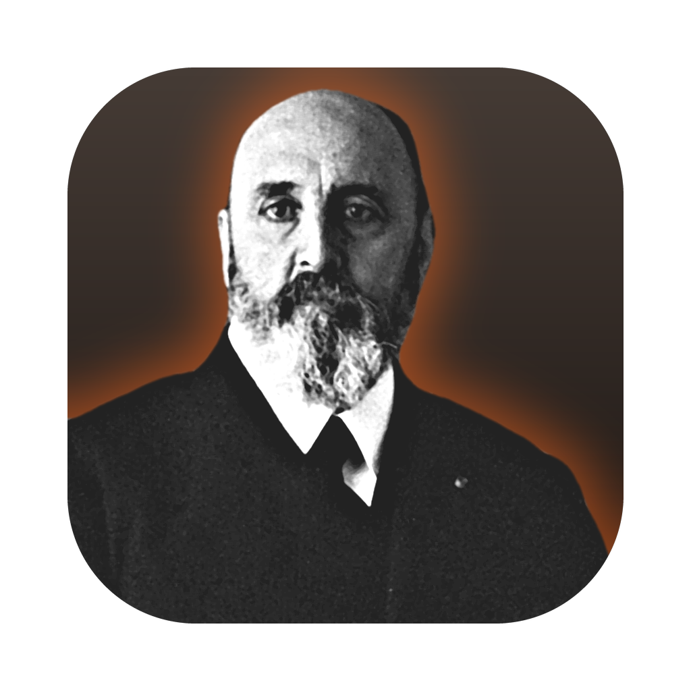
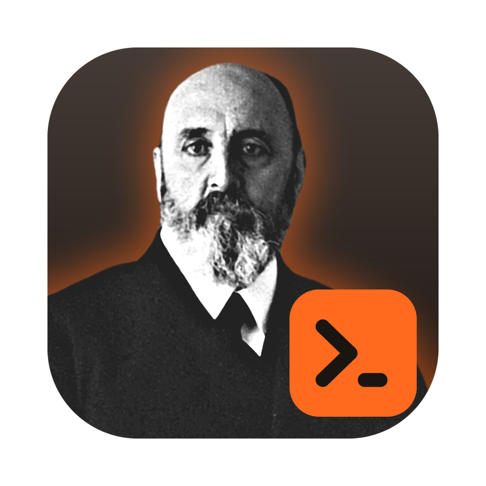

# Icon

  
  

## Concept

Every Nodalia application is represented by a black-and-white portrait of someone who stands
for what the application does, on the application's colour: Bernoulli for Vortia, Leonardo for
Forja, Velázquez for Lienzo. Lumbre follows the family.

**The sitter is Leonardo Torres Quevedo** (1852–1936), the Spanish engineer who built
*El Ajedrecista* in 1912 — a machine that played a chess endgame on its own, against a person,
and won — and who wrote, in his 1914 *Ensayos sobre Automática*, about machines that would
decide for themselves what to do next. A machine that reasons, built to run on its own, with
no one behind it: that is the idea Lumbre is named for.

**The colour is charcoal**, the only dark field in the family, and it comes with an ember.
*Lumbre* is the household fire — not a blaze, the glow that is kept going. So the portrait sits
on charcoal and is lit from behind by an ember-orange glow. On a dark field the family's usual
drop shadow would disappear and the sitter's dark suit would sink into the background; the
glow does both jobs, and it is the name of the application drawn once.

**Lumbre Código** is the same portrait with a prompt, `›_`, on an ember tile in the lower right
corner: recognisably the same application, at work in a terminal. The tile stays legible down to
32 px; at 16 px it reads as an ember-coloured corner, which is still enough to tell the two
apart in a task bar.

An earlier direction — an abstract geometric symbol — was sketched and set aside in favour of
the family's portraits.

## Colours

| | |
| --- | --- |
| Charcoal (field, top → bottom) | `#453B35` → `#1B1512` |
| Ember (glow, Código tile, interface accent) | `#FF6A1F` |

Lumbre's accent in the Nodalia Design Language should be derived from the ember, not from the
charcoal: a dark neutral cannot carry selection and focus. That is one line in `accents.json` of
`nodalia-design`, and it has **not** been made yet; until it is, the desktop app uses the
default Nodalia accent. Ember is close to Pluma's orange (`#EE5A14`), so the two accents will
look related in the interface even though the icons do not.

## Files

| File | Use |
| --- | --- |
| `assets/icons/lumbre.png`, `lumbre-code.png` | 1024 px master with the rounded shape and margin (Linux, Windows, documentation) |
| `assets/icons/lumbre-fullbleed.png`, `lumbre-code-fullbleed.png` | 1024 px square, for systems that apply their own mask |
| `assets/icons/png/<name>-{16,24,32,48,64,128,256,512}.png` | Linux icon theme sizes |
| `assets/icons/<name>.ico` | Windows (16–256 px) |
| `assets/icons/<name>.icns` | macOS |
| `design/icon/` | Source photograph, mask, and the script that composes the icons |

A portrait is a raster image, so there is no hand-editable SVG of the whole icon as there would
be for a glyph. The editable source is the script: crop, tones, colours, glow strength and the
Código mark are parameters at the top of [`design/icon/compose.py`](../design/icon/compose.py),
and the mark itself is drawn as vector shapes there.

Provenance and licence of the photograph: [`design/icon/SOURCE.md`](../design/icon/SOURCE.md).

## Not done

- The Linux `.desktop` entry and icon-theme installation come with packaging.
- The macOS bundle and the Windows executable resource, likewise.
- The icon has been reviewed at 16–400 px on light and dark backgrounds, not yet in a real
  launcher or dock.
